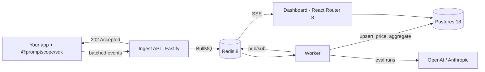

# Promptscope

Self-hosted LLM observability and evals: every LLM call in your app becomes a trace with cost and
latency, and every prompt change gets an eval that says whether it got better.

- **Traces** – spans for LLM calls, tools, retrieval and HTTP, with tokens and server-side pricing
- **Dashboard** – cost by model, p50/p95 latency, error rate, a waterfall per trace, live updates
- **Prompt registry** – immutable versions, diffs, `production` / `staging` labels fetched by the SDK
- **Datasets and evals** – code checks plus LLM-as-judge, side-by-side comparison of two versions

## Architecture



The SDK never waits for the database: ingest validates a batch and queues it, and the worker writes
it. Why: [ADR 0002](docs/adr/0002-queue-between-ingest-and-db.md). Stack choices:
[ADR 0001](docs/adr/0001-monorepo-and-stack.md). Judge bias: [ADR 0003](docs/adr/0003-llm-as-judge.md).

| Path              | What                                                        |
| ----------------- | ----------------------------------------------------------- |
| `apps/web`        | Dashboard: auth, organizations, all screens from the design |
| `apps/ingest`     | `POST /v1/ingest`, `GET /v1/prompts/:name`                  |
| `apps/worker`     | Writes batches, prices spans, runs evals, applies retention |
| `packages/sdk`    | `@promptscope/sdk` for Node                                 |
| `packages/db`     | Drizzle schema, migrations, demo data                       |
| `packages/shared` | Zod event schemas, scorers, API keys, pricing               |

## Numbers

Measured on a MacBook (Apple silicon) with Postgres and Redis in Docker. Reproduce with
`pnpm --filter @promptscope/ingest load-test`.

| What                                                       | Result                                                          |
| ---------------------------------------------------------- | --------------------------------------------------------------- |
| Ingest, 32 connections, 50 spans per request               | 5,900 requests/s (295,000 spans/s), p50 4.8 ms, p99 9.9 ms      |
| Worker, 4 concurrent batches                               | about 21,000 spans/s into partitioned Postgres                  |
| Traces page on a project with 103,000 traces / 4.4 M spans | 28–42 ms server time with filters and sorting                   |
| Overview on the same project                               | 0.77 s (aggregates over raw spans; first candidate for rollups) |

Tests: 82 unit tests (17 shared, 14 SDK, 7 ingest, 9 worker, 2 db, 33 dashboard) and 2 Playwright flows.

## Quickstart (SDK)

```bash
pnpm add @promptscope/sdk
```

```ts
import OpenAI from 'openai';
import { Promptscope, wrapOpenAI } from '@promptscope/sdk';

const ps = new Promptscope({ apiKey: process.env.PROMPTSCOPE_API_KEY });
const openai = wrapOpenAI(new OpenAI());

await ps.trace('support.answer', async () => {
  const prompt = await ps.getPrompt('support-reply'); // the production version, cached
  return openai.chat.completions.create({
    model: 'gpt-4.1-mini',
    messages: [{ role: 'user', content: prompt.compile({ message: 'Where is my order?' }) }],
  });
});
```

More in [packages/sdk/README.md](packages/sdk/README.md).

## Self-host in five steps

```bash
cp .env.example .env            # set BETTER_AUTH_SECRET and DEMO_USER_PASSWORD
pnpm install
pnpm services:up                # Postgres 18 and Redis 8 in Docker
pnpm db:migrate && pnpm db:seed # schema and a demo project with two weeks of traces
pnpm dev                        # dashboard :5173, ingest :4318, worker
```

Open http://localhost:5173, create an account or press **Open live demo**.

## Deploy (Railway)

One `Dockerfile` builds every service; the `APP` build argument picks which one.

1. Create a project with the Postgres and Redis plugins.
2. Add three services from this repository with config files `apps/web/railway.json`,
   `apps/ingest/railway.json` and `apps/worker/railway.json`, and set `APP` to `web`, `ingest`
   and `worker`.
3. Give every service `DATABASE_URL` and `REDIS_URL` from the plugins. The web service also needs
   `BETTER_AUTH_SECRET`, `BETTER_AUTH_URL` (its public URL), `DEMO_USER_PASSWORD` and
   `PUBLIC_INGEST_URL`; the worker needs `OPENAI_API_KEY` / `ANTHROPIC_API_KEY` for eval runs.
4. Before each deploy the web service runs the migrations and the seed script. Seeding is idempotent:
   it adds model prices and creates the demo project only if it does not exist yet.

## Development

```bash
pnpm typecheck && pnpm lint && pnpm test   # what CI runs
pnpm e2e                                    # Playwright against the dev servers
pnpm db:generate                            # after changing packages/db/src/schema
```

## What's next

Python SDK, OpenTelemetry ingest, ClickHouse or rollup tables for aggregates, SSO/SAML, billing,
a prompt playground, and an eval CLI for CI (`promptscope eval --fail-under 4.0`).
